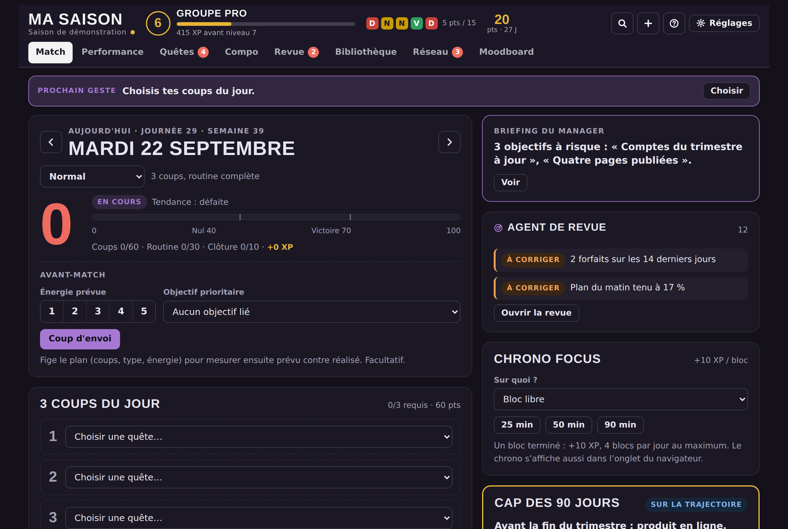
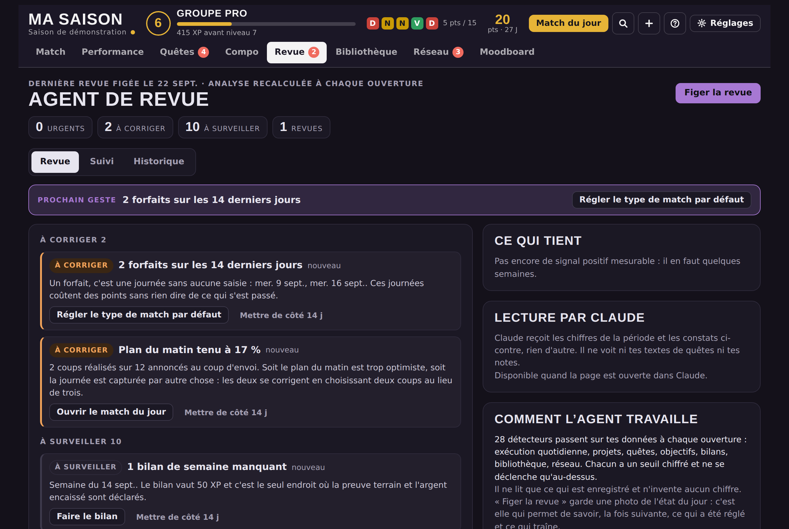
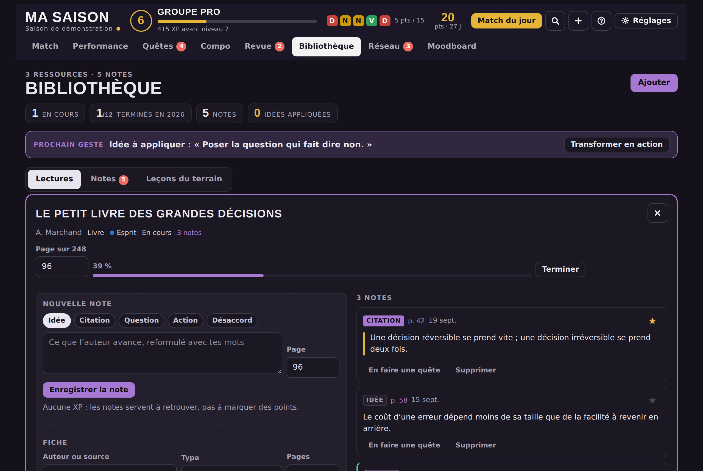
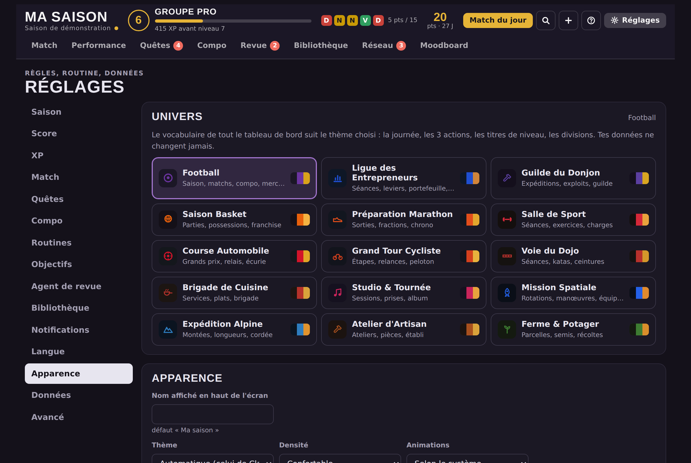
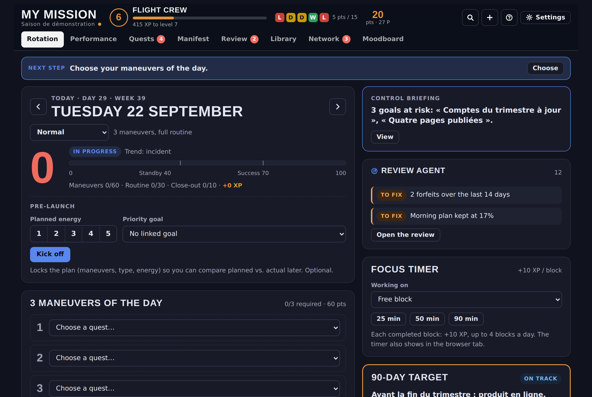

# Ma Saison

**Un tableau de bord de vie où chaque journée est un match noté sur 100.**

Trois actions choisies le matin, une routine, un rituel de clôture le soir. Le reste — score, points, XP, niveau, division, trophées — se calcule tout seul à partir de ce que tu as réellement fait. Rien n'est déclaratif : si une donnée n'est pas saisie, elle n'existe pas et la journée est perdue par forfait.

Une seule page HTML, sans serveur, sans compte, sans dépendance au moment de l'exécution. Tes données restent chez toi.



---

## Essayer en trente secondes

1. Télécharge [`dist/ma-saison.html`](dist/ma-saison.html) *(bouton « Download raw file » en haut à droite du fichier)*.
2. Ouvre-le dans ton navigateur. C'est tout.

Le fichier est autonome : tout le code, tous les styles, les polices et les trois langues sont dedans. Il fonctionne entièrement hors ligne et n'appelle aucun service tiers.

Au premier lancement, l'application te demande de créer ta saison et de choisir ton univers. Pour voir à quoi ressemble une saison déjà commencée, charge le jeu de démonstration (voir [Jeu de démonstration](#jeu-de-démonstration)).

---

## Le principe

| | |
|---|---|
| **Le match** | Une journée. Notée sur 100 : les 3 coups du jour valent 60 points, la routine 30, la clôture du soir 10. Au-dessus de 70 c'est une victoire, entre 40 et 70 un match nul, en dessous une défaite. |
| **Les 3 coups** | Trois quêtes choisies le matin. Trois, pas dix. Les terminer toutes les trois le jour même donne le coup du chapeau. |
| **Le coup d'envoi** | Le geste du matin qui fige le plan. Il permet de comparer ensuite ce qui était prévu à ce qui a été fait. |
| **Le Full Time** | Deux minutes le soir : ce qui a été livré, le blocage principal, l'ajustement pour demain. C'est lui qui alimente toutes les analyses. |
| **La compo** | Trois projets actifs au maximum. Un capitaine (XP × 2), deux titulaires (× 1), le banc (× 0,5), la tribune (× 0). Changer de poste passe par le mercato et prend effet au prochain match. |
| **Les quêtes** | Binaires : faites ou pas. *Livrer* (ce qui sort de ta tête vers le monde), *Terrain* (un contact réel), *Fond* (préparer, étudier). Les poids diffèrent exprès. |
| **La saison** | Plusieurs mois, un cap de 90 jours, des objectifs par semaine, mois et saison. La carrière, elle, ne s'arrête jamais. |

Le score mesure l'exécution du jour, les points mesurent la régularité, l'XP mesure ce qui a été accompli, le niveau mesure l'expérience accumulée. Quatre choses distinctes, qui ne se compensent pas.

---

## Ce que l'application contient

### L'agent de revue



Vingt-huit détecteurs passent sur les données à chaque ouverture : forfaits répétés, clôtures sautées, score en baisse, routine qui décroche, habitude jamais cochée, capitaine inactif, projets qui stagnent, dispersion entre domaines, ratio Terrain/Livrer trop faible, quêtes bloquées, plan du matin non tenu, cap et objectifs à risque, bilans manqués, semaines sans preuve extérieure, lectures abandonnées, réseau refroidi, jour faible récurrent…

Chaque détecteur a un **seuil chiffré** et se tait en dessous. Chaque constat **cite les chiffres qui l'ont déclenché** — rien n'est inventé.

Ce n'est pas une liste d'alertes : un constat devient une quête en un clic, et l'onglet **Suivi** montre ensuite ce qui a été fait de chaque recommandation, quels constats ont disparu et lesquels s'installent. « Figer la revue » enregistre une photo de l'état du jour ; c'est elle qui permet la comparaison la fois suivante.

### La bibliothèque



Les lectures (livres, articles, cours, podcasts, vidéos) et les notes qui vont avec. Une note est toujours rattachée à ce qu'on lisait, avec son type — **idée, citation, question, action, désaccord** — et son numéro de page. L'onglet *Notes* les rassemble toutes, avec recherche plein texte et épinglage.

Une note de type *action* devient une quête Terrain en un clic. C'est volontairement le seul chemin entre une lecture et une journée réelle.

**Les notes ne rapportent aucune XP.** C'est un choix : payer la prise de notes pousse à préparer au lieu d'agir. L'XP arrive quand une ressource est terminée avec son idée clé, et une seconde fois quand l'idée est appliquée pour de vrai.

### Le reste

- **Performance** — semaine, mois, saison, carrière, analyses. Heatmap, jours forts et faibles, équilibre entre domaines, corrélation entre habitudes et victoires, records, trophées, récompenses que tu définis toi-même.
- **Quêtes** — filtres, recherche, reports tracés, découpage d'une quête trop grosse, répétitions (tous les jours, 7 jours, 14 jours, mensuel).
- **Chrono focus** — blocs de 25, 50 ou 90 minutes, liés ou non à une quête, décompte visible dans l'onglet du navigateur.
- **Réseau** — contacts avec cadence de relance ; les retards remontent sur l'écran du jour.
- **Moodboard** — images, citations, couleurs, liens. Un élément épinglé réapparaît chaque jour.
- **Guide intégré** — seize sections qui lisent tes réglages réels, pas des valeurs d'exemple.

---

## Quinze univers, trois langues



La métaphore du football n'est qu'une peau. Au moment de créer ta saison, tu choisis parmi quinze univers — et tu peux en changer ensuite dans *Réglages › Apparence* :

| | | |
|---|---|---|
| Football · match, coups, compo | Ligue des Entrepreneurs · séances, leviers, portefeuille | Guilde du Donjon · expéditions, exploits |
| Basket · parties, possessions | Préparation Marathon · sorties, fractions | Salle de Sport · séances, exercices |
| Course Automobile · grands prix, relais | Grand Tour Cycliste · étapes, relances | Voie du Dojo · séances, katas, ceintures |
| Brigade de Cuisine · services, plats | Studio & Tournée · sessions, prises | Mission Spatiale · rotations, manœuvres |
| Expédition Alpine · montées, longueurs | Atelier d'Artisan · ateliers, pièces | Ferme & Potager · parcelles, semis |

Chaque univers apporte son vocabulaire complet (journée, action du jour, ouverture, clôture, résultats, quatre statuts de projet, neuf titres de niveau, six divisions), sa palette et son icône — **dans les trois langues**.



L'interface existe en **français, anglais et espagnol**, changeable à chaud, y compris les dates, les nombres et les analyses. Tes propres textes ne sont jamais traduits.

Rien de tout cela ne touche aux données : seuls l'affichage, les couleurs et l'icône changent. Le moteur de score, les identifiants et l'historique restent identiques.

<details>
<summary>Comment le vocabulaire est réécrit (détail technique)</summary>

Un univers n'est pas une table de traduction figée : c'est un **lexique d'environ quarante-cinq mots par langue** (`js/36-themes.js`) et un moteur (`js/35-theme-engine.js`) qui en dérive 185 à 250 règles de remplacement, appliquées au moment de l'affichage sur la table de chaînes active.

Le moteur gère les accords du français et de l'espagnol — articles, genre, élision, participes : « la séance clôturée », « el partido cerrado », « Los 3 acelerones terminados ». Il ne réécrit que le texte visible : jamais les balises, les classes, les identifiants ni les attributs techniques.

Coût : environ 50 Ko de lexiques, contre près de 900 Ko s'il avait fallu embarquer une table de chaînes complète par univers.

</details>

---

## Où vivent les données

**Le fichier ouvert directement dans un navigateur** range tout dans le `localStorage` de ce navigateur. Rien ne sort de la machine : il n'y a ni serveur, ni compte, ni télémétrie, ni aucun appel réseau, polices comprises. Sauvegarde automatique locale, export JSON et CSV, import, et une section « Tout supprimer » qui supprime vraiment tout.

**La même page publiée comme artifact Claude** peut utiliser la base privée de la page : les mêmes données sur téléphone et ordinateur, et la possibilité de demander une interprétation des chiffres à Claude. Dans ce mode, l'application déclare trois capacités — base de données, génération de texte, téléchargement de fichiers — et continue de fonctionner si elles sont refusées.

Dans les deux cas, l'interprétation par Claude ne reçoit **que des chiffres agrégés et les constats de l'agent**, jamais le texte de tes quêtes ni tes notes. Le contexte personnel transmis est celui que tu écris toi-même dans *Réglages › Avancé*, et rien d'autre.

> **Avertissement.** Le `localStorage` d'un navigateur n'est pas un coffre-fort : vider les données du site efface la saison. Exporte en JSON de temps en temps (*Réglages › Données*).

---

## Jeu de démonstration

Pour voir l'application avec quatre semaines déjà jouées :

```bash
python3 test/demo-data.py      # écrit dist/demo.json et dist/demo-neutral.json
```

Ouvre `dist/ma-saison.html`, puis dans la console du navigateur :

```js
localStorage.setItem('ma-saison-v2:data', '<le contenu de dist/demo.json>');
location.reload();
```

Plus simple : *Réglages › Données › Importer un JSON*, et choisis `dist/demo.json`.

Les données sont entièrement inventées et déterministes : une saison en cours, vingt-six journées avec des victoires, des nuls, des défaites, deux forfaits et une trêve, une compo complète, des quêtes en retard et bloquées, des objectifs tenus et à risque, des lectures annotées, un réseau à relancer, deux Cups et un bilan de semaine. Elles sont construites pour déclencher une partie des détecteurs de l'agent : c'est aussi ce qui rend les tests utiles.

---

## Construire soi-même

**Prérequis** : Python 3.8+ et Node.js 18+.

```bash
cd tools && npm install && cd ..     # acorn, acorn-walk et les polices embarquées
python3 build.py
```

Produit :

- `dist/ma-saison.html` — version Football
- `dist/ligue-des-entrepreneurs.html` — version Ligue des Entrepreneurs, chaînes réécrites au build

Le build concatène `js/*.js` dans l'ordre des noms de fichiers et `css/{a,b,c}.css`, puis fait passer l'ensemble par l'extracteur d'internationalisation, qui remplace chaque texte visible par un appel à la table de chaînes et vérifie qu'aucune traduction ne manque. Il échoue bruyamment si c'est le cas.

### Tests

```bash
npm install -g playwright sharp && playwright install chromium   # sharp : comparaison d'images de t4
python3 test/demo-data.py
NODE_PATH=$(npm root -g) node test/t1.js
```

| Fichier | Ce qu'il vérifie |
|---|---|
| `t1.js` | Parcours complet : journée, score, XP, mercato, figeage du passé, absence prolongée, mobile |
| `t2-db.js` | Mode base de données : écritures, sauvegardes, restauration, exports, refus de saisie invalide |
| `t3-ligue.js` | Version Ligue : aucun mot de football ne subsiste à l'écran, stockage séparé |
| `t4-features.js` | Focus, moodboard, récompenses, trophées, guide, accessibilité, mobile |
| `t5-i18n.js` | Les trois langues sur un parcours complet, dates et nombres localisés |
| `t6-plus.js` | Quêtes récurrentes, découpage, plan du lendemain, sauvegardes locales |
| `t7-themes.js` | Les quinze univers × trois langues : vocabulaire résiduel, accords, palette |
| `t8-agent-lib.js` | Agent de revue, bibliothèque, notes, nouveau départ |
| `t9-securite.js` | Données importées piégées : 250+ champs avec injection HTML, liens `javascript:`, image et couleur piégées ; rien ne s'exécute, aucun lien dangereux |

Les neuf suites tournent sans serveur, sur le fichier construit, horloge figée au 22 septembre 2026.

### Avant de publier une version modifiée

```bash
python3 tools/check-prive.py .
```

L'application range tout ce qui te concerne dans sa base ou dans le stockage du navigateur — jamais dans le code. Mais les textes d'exemple, les placeholders et les jeux de test sont écrits à la main : c'est là que des données personnelles fuient. Mets ce qui t'est propre (nom, ville, employeurs, projets, personnes), un terme par ligne, dans `.prive-termes.txt` à la racine : ce fichier est ignoré par git, donc la liste de ce qui ne doit pas fuiter ne fuit pas elle-même. Le script sort en erreur s'il trouve quelque chose, et s'utilise tel quel en pré-commit.

---

## Structure du dépôt

```
js/                  le code, découpé en fichiers numérotés dans l'ordre de chargement
  00-util            dates locales, libellés, icônes
  01-settings        réglages, valeurs par défaut, langue, thème actif
  02-data            base ou navigateur, file d'écriture
  03→06              domaine, score, XP, analyses
  09-look            palettes et recalcul de contraste
  10→24              interface : écrans, composants, surcouches
  30→34              actions
  35-theme-engine    moteur de réécriture du vocabulaire
  36-themes          les quinze lexiques
  38-agent           les détecteurs de l'agent de revue
  40-events-boot     événements, maintenance, démarrage
css/                 a (base), b (composants), c (écrans), theme-ligue
i18n/tr.json         traductions anglaise et espagnole, indexées par le texte français
tools/               extracteur d'internationalisation, générateur de thème, vérificateurs,
                     contrôle de confidentialité avant publication
test/                neuf suites Playwright et le générateur de données de démonstration
dist/                les fichiers construits
docs/                architecture, modèle de données, ajout d'un univers, traduction
```

Pas de framework, pas d'étape de transpilation, pas de dépendance au moment de l'exécution. Les dépendances Node ne servent qu'à construire et à tester.

---

## Pour aller plus loin

- [`docs/ARCHITECTURE.md`](docs/ARCHITECTURE.md) — comment la page est assemblée, comment le rendu fonctionne, pourquoi un score passé ne change jamais
- [`docs/DONNEES.md`](docs/DONNEES.md) — le modèle de données, collection par collection
- [`docs/UNIVERS.md`](docs/UNIVERS.md) — ajouter un seizième univers
- [`docs/TRADUCTION.md`](docs/TRADUCTION.md) — ajouter une langue
- [`docs/ARTIFACT.md`](docs/ARTIFACT.md) — publier la page comme artifact Claude

---

## Limites connues

- **Un seul utilisateur, un seul appareil** par défaut. La synchronisation entre appareils n'existe que via la base d'un artifact Claude, ou en exportant et important le JSON à la main.
- **Les textes d'aide les plus longs** (le guide, les descriptions de réglages) gardent quelques tournures footballistiques dans les treize univers autres que Football et Ligue : le moteur réécrit les mots, pas les phrases entières.
- **Le `localStorage` a une limite** d'environ 5 Mo. Un moodboard chargé d'images peut l'atteindre ; l'application prévient quand l'écriture échoue.
- **Pas de rendu serveur, pas de PWA, pas de notifications natives.** Les rappels existants passent par des tâches programmées côté Claude.
- **Testé sur Chromium.** Firefox et Safari fonctionnent, mais ne sont pas couverts par les suites automatiques.

---

## Sécurité et confidentialité

- **Aucune requête réseau.** Les polices sont embarquées dans le fichier (plus d'appel à Google Fonts, donc plus d'adresse IP transmise à un tiers) ; le build échoue si une ressource externe réapparaît.
- **Les données importées sont traitées comme non fiables.** Un JSON reçu de quelqu'un d'autre ne peut ni exécuter de code ni glisser un lien `javascript:` : textes échappés, liens limités à `http(s)`, images limitées aux images encodées, couleurs validées. Vérifié par `test/t9-securite.js`.
- **Contrôle de confidentialité avant publication** : `python3 tools/check-prive.py .`, avec tes termes personnels dans `.prive-termes.txt` (non versionné).
- Signalement d'une faille : [SECURITY.md](SECURITY.md).

## Licence

© Florian Iglesias. Tous droits réservés.

Le code est public pour être lu, et le fichier construit est librement **utilisable à titre personnel** : télécharge-le, ouvre-le, sers-t'en tous les jours, modifie-le pour toi. Ce qui n'est pas accordé : la redistribution, la republication sous un autre nom et l'usage commercial. Pour tout le reste, demande.

Voir [`LICENSE`](LICENSE).

---

<details>
<summary><b>English summary</b></summary>

**Ma Saison** is a self-contained life dashboard where each day is a match scored out of 100: pick three quests in the morning, tick your routine, close the day in two minutes. Score, points, XP, level, division, trophies and records are all derived from what you actually recorded — nothing is declarative.

One HTML file. No server, no account, no runtime dependency, no telemetry. Data lives in your browser's local storage, or in the private database of a published Claude artifact.

Highlights:

- **Review agent** — 28 deterministic detectors with numeric thresholds, each quoting the figures that triggered it; findings turn into quests, and a tracking tab shows what you did about them.
- **Library** — readings with typed, paginated notes (idea, quote, question, action, disagreement); an *action* note becomes a field quest in one click. Notes deliberately earn no XP.
- **Fifteen universes** — football, founders' league, dungeon guild, basketball, marathon, gym, motor racing, cycling, dojo, kitchen brigade, studio, space mission, alpine expedition, craft workshop, farm — each with a full vocabulary, palette and icon, **in all three languages**.
- **Three languages** — French, English, Spanish, switchable at runtime, including dates, numbers and analyses. Your own text is never translated.

Get started: download [`dist/ma-saison.html`](dist/ma-saison.html) and open it. To build: `cd tools && npm install && cd .. && python3 build.py` (Python 3.8+, Node 18+). To test: nine Playwright suites in `test/`.

© Florian Iglesias. All rights reserved — personal use of the built file is granted; redistribution, republication and commercial use are not.

</details>
